# MEEHOA OPS — BÁO CÁO PHÂN TÍCH & GIẢI PHÁP TỐI ƯU CHI PHÍ HẠ TẦNG (EGRESS)

> **Mục tiêu:** Giảm phụ thuộc vào gói Supabase Pro (\$25/tháng) và Egress Over-quota, đưa hệ thống về mức vận hành miễn phí (\$0/tháng) hoặc chi phí cực thấp cho quy mô doanh nghiệp nhỏ (SME), bảo đảm tốc độ và an toàn dữ liệu 100%.

---

## 1. BỐI CẢNH & NGUYÊN NHÂN GỐC CỦA CHI PHÍ

### 1.1. Hiện trạng đo đạc thực tế (Chu kỳ tính phí tháng 10–11/2026)
Dựa trên số liệu chính thức từ Supabase Dashboard (`zxnfhshnavbmvdthrmrd`):
- **Dung lượng Database:** **49 MB** (Hạn mức Free: 500 MB) $\rightarrow$ **ĐẠT AN TOÀN** (chỉ chiếm ~9.8% quota).
- **Lượt gọi Edge Functions:** **35.401 lượt/tháng** (Hạn mức Free: 500.000 lượt) $\rightarrow$ **ĐẠT AN TOÀN** (chỉ chiếm ~7.1% quota).
- **Lưu trữ Storage (Objects):** **0.556 GiB** (Hạn mức Free: 1.0 GiB) $\rightarrow$ **ĐẠT AN TOÀN** (chỉ chiếm ~55.6% quota).
- **Google Sheets Writeback:** Đã chủ động ngừng sử dụng từ 27/10/2026 $\rightarrow$ Lượt gọi và egress phát sinh từ Sheets = **0 MB**.
- **BĂNG THÔNG TẢI XUỐNG (EGRESS):** **24.013 GB uncached** $\rightarrow$ **VI PHẠM QUOTA GÓI FREE** (Gói Free chỉ cho phép 5 GB uncached/tháng).

### 1.2. Điểm nghẽn duy nhất
**95% băng thông tiêu thụ đến từ việc tải ảnh gốc (`order-images` và `settlement-bills`).**
- Trung bình mỗi ngày phát sinh **260 MB – 370 MB** tải ảnh.
- Khi người dùng vào trang Đơn hàng, Sản xuất hoặc Payment Check, trình duyệt tải trực tiếp ảnh gốc (kích thước trung bình ~272 KiB - 550 KiB/ảnh) thay vì ảnh thumbnail đã nén (15 - 30 KiB).
- Nếu giải quyết được bài toán **lưu trữ và phân phối ảnh**, toàn bộ hệ thống Database và API hoàn toàn đủ điều kiện vận hành trên **gói Free $0/tháng**.

---

## 2. PHÂN TÍCH SO SÁNH 3 PHƯƠNG ÁN HẠ TẦNG

```mermaid
flowchart TD
    subgraph Option1["Phương án 1: Giữ nguyên Supabase + Nén ảnh tại client"]
        O1_App[Trình duyệt Meehoa Ops] -->|Resize WebP tại Client| O1_Store[Supabase Storage 1GB]
        O1_Store -->|Egress bị giới hạn 5GB| O1_User[User xem ảnh]
    end

    subgraph Option2["Phương án 2: Tách Storage sang Cloudflare R2 (KHUYẾN NGHỊ)"]
        O2_DB[Supabase Postgres Free] -->|Dữ liệu đơn hàng 49MB| O2_App[Meehoa Ops App]
        O2_App -->|Tải & xem ảnh| O2_R2[Cloudflare R2 Storage]
        O2_R2 -->|BĂNG THÔNG $0 / ZERO EGRESS| O2_User[User xem ảnh mượt mà]
    end

    subgraph Option3["Phương án 3: Chuyển toàn bộ sang Cloudflare D1 + Workers"]
        O3_CF[Cloudflare Pages + Workers] -->|Database SQL| O3_D1[Cloudflare D1]
        O3_CF -->|Storage| O3_R2_2[Cloudflare R2]
    end
```

### So sánh chi tiết

| Tiêu chí | Phương án 1: Tối ưu trên Supabase hiện tại | Phương án 2: Tách ảnh sang Cloudflare R2 (Khuyến nghị) | Phương án 3: Chuyển toàn bộ sang Cloudflare D1/Workers |
| :--- | :--- | :--- | :--- |
| **Mô hình kiến trúc** | Giữ Supabase Pro hoặc hạ xuống Free; nén ảnh thật chặt ở client trước khi upload. | **Supabase Free (DB & Auth) + Cloudflare R2 (Ảnh & Bill)** | Chuyển hoàn toàn sang hệ sinh thái Cloudflare (Workers + D1 + R2). |
| **Chi phí hàng tháng** | \$0 – \$25/tháng (dễ bị vượt trần 5GB nếu đơn tăng). | **\$0/tháng** (R2 miễn phí 10GB lưu trữ, **băng thông \$0 vĩnh viễn**). | **\$0/tháng** (D1 + R2 + Workers đều có free tier rất lớn). |
| **Hạn mức băng thông (Egress)** | 5 GB/tháng (Free) $\rightarrow$ Nguy cơ nghẽn khi dịp lễ/Tết. | **KHÔNG GIỚI HẠN BĂNG THÔNG** (Cloudflare zero egress fee). | **KHÔNG GIỚI HẠN BĂNG THÔNG**. |
| **Độ rủi ro kỹ thuật** | Thấp (giữ nguyên mã nguồn backend). | **Rất thấp** (Backend chỉ cần đổi URL lưu trữ ảnh, giữ nguyên 100% logic Postgres/RLS). | **Cao** (Phải viết lại toàn bộ stored procedures, trigger Postgres sang SQLite D1). |
| **Thời gian triển khai** | 1 ngày. | **1–2 ngày** (Đã có sẵn module chuẩn bị trong repo). | 2–3 tuần (Cần kiểm thử lại toàn bộ nghiệp vụ tài chính, nợ, KPI). |
| **Phù hợp với SME** | Tạm thời (dễ chạm trần khi mở rộng kinh doanh). | **Tối ưu nhất cho doanh nghiệp vừa và nhỏ (Bền vững, \$0/tháng).** | Dành cho tương lai khi quy mô hàng triệu đơn/tháng. |

---

## 3. PHÂN TÍCH ƯU & NHƯỢC ĐIỂM TỪNG PHƯƠNG ÁN

### Phương án 1: Giữ nguyên Supabase + Client-side Thumbnails
- **Ưu điểm:** Không cần tạo thêm tài khoản hạ tầng mới.
- **Nhược điểm:**
  - Trần 5 GB/tháng của Supabase Free quá mong manh (chỉ cần 150 đơn/ngày với vài ảnh xem lại là chạm ngưỡng).
  - Khi chạm 5 GB, Supabase sẽ chặn tải ảnh hoặc phát sinh chi phí phạt nếu bật thanh toán tự động.

### Phương án 2: Kiến trúc Hybrid — Supabase Free (Data) + Cloudflare R2 (Media) — [KHUYẾN NGHỊ CAO NHẤT]
- **Ưu điểm:**
  - **Triệt tiêu 100% nỗi lo Egress:** Cloudflare R2 nổi tiếng toàn cầu với chính sách **Zero Egress Fees** (không tính phí tải ra dù 10 GB hay 10.000 GB).
  - **Miễn phí 100%:** R2 miễn phí 10 GB dung lượng (Meehoa hiện chỉ dùng 0.55 GB, tức chỉ chiếm 5.5% hạn mức miễn phí).
  - **Giữ nguyên 100% tính toàn vẹn của nghiệp vụ tài chính:** Toàn bộ bảng `orders`, `settlement_requests`, `kpi_operations`, các trigger kiểm toán và phân quyền RLS trên Supabase Postgres giữ nguyên, không sợ sai lệch dù chỉ 1 đồng.
  - **Ảnh tải siêu nhanh:** Nhờ mạng lưới CDN hơn 300 thành phố trên thế giới của Cloudflare.
- **Nhược điểm:** Cần cấu hình một Cloudflare Worker hoặc presigned URL cho việc upload ảnh.

### Phương án 3: Chuyển dịch toàn diện sang Cloudflare D1
- **Ưu điểm:** Gom toàn bộ hệ thống về một nhà cung cấp duy nhất (Cloudflare).
- **Nhược điểm:** SQLite của Cloudflare D1 không hỗ trợ nhiều tính năng nâng cao của Postgres (Stored procedures phức tạp, atomic row locking `FOR UPDATE` dùng cho kiểm toán thanh toán). Rủi ro phát sinh lỗi nghiệp vụ công nợ và KPI là rất lớn.

---

## 4. PHƯƠNG ÁN KHUYẾN NGHỊ VÀ LỘ TRÌNH THỰC HIỆN

### Khuyến nghị chính thức
Áp dụng **Phương án 2 (Supabase Free + Cloudflare R2)**:
1. **Dữ liệu & API:** Giữ nguyên trên Supabase Free (49 MB DB, 35k gọi hàm $\rightarrow$ Miễn phí vĩnh viễn, không lo chạm trần).
2. **Ảnh chứng từ & Mẫu hoa:** Lưu trên bucket Cloudflare R2 gắn domain tĩnh riêng (ví dụ `img.meehoasg.com` hoặc R2 public URL).
3. **Phía Client:** Giảm dung lượng ảnh tải lên bằng WebP canvas compression trước khi gửi.

### Lộ trình 3 bước chuyển đổi an toàn:
1. **Bước 1 (Đã hoàn tất):** Tắt hoàn toàn đồng bộ Google Sheets, tối ưu kích thước phân trang (Payment Check 20 items/trang), lazy loading ảnh chứng từ.
2. **Bước 2 (Chuyển tiếp R2):** Cấu hình bucket Cloudflare R2 miễn phí, đồng bộ 0.55 GB ảnh hiện có từ Supabase Storage sang R2.
3. **Bước 3 (Hạ gói):** Chuyển gói Supabase sang Free Tier sau khi kiểm chứng chu kỳ 30 ngày băng thông dưới 500 MB. Chi phí vận hành hạ tầng Meehoa Ops đưa về **0 VNĐ/tháng**.
